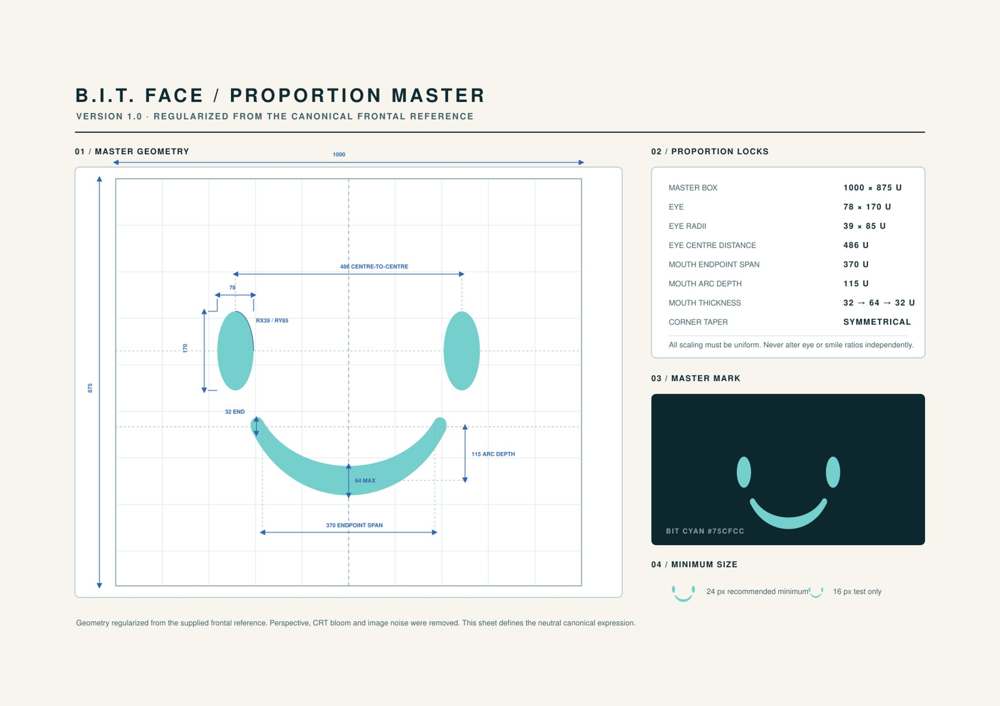

# BIT reference sources

Read the [locked BIT character specification](../../../docs/bit-character-spec.md) before any BIT artwork.

## Authoritative face sheet

[BIT-Face-Proportion-Master-v1_A4-print_2.jpg](BIT-Face-Proportion-Master-v1_A4-print_2.jpg) is the unchanged original uploaded by the owner in the ChatGPT conversation “Analysera spelarfedback” (14 November 2026; conversation ID `6af75a8b-599c-83ed-9753-899cb9b589df`). It defines the canonical face proportions and `#75CFCC` color.

- Original filename retained; no crop, resize, recompression or color adjustment.
- File size: 194011 bytes.
- SHA-256: `2d19d0b9ef893bc54df85093effc8e4e3198c081b1503a82160d3892612b3e08`.

## Preserved vector and body context

- [Current canonical face SVG v3](../../bit-face-master-v3.svg): owner-authorized new version using the sheet's 370 U mouth span and other printed dimensions; use for all new artwork.
- [Unchanged legacy face SVG v2](../../bit-face-master.svg): historical ~387 U mouth span; preserve byte-for-byte. See [version reconciliation and measurement definitions](../../../docs/bit-character-spec.md#version-3--image-authoritative-reconciliation).
- [Selected October body sheet](oct25/bit-master-sheet-v2.png): silhouette/material context only, subordinate to the face sheet.
- [October handoff](../../../docs/art-oct25-handoff.md): historical asset delivery and owner correction banning external cyan side strips.

Do not overwrite, rename or replace existing masters. New derivatives require distinct paths and documented provenance. Generated facial features and legacy emotion names are not authorities.
