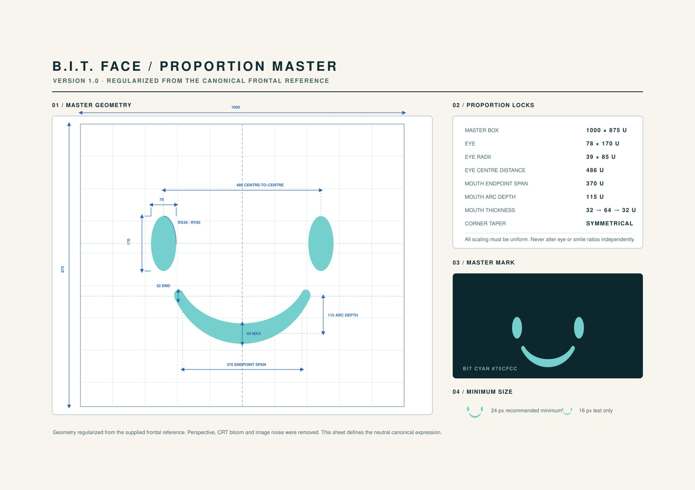

# BIT character specification

Protocol Rebirth · Locked visual identity · Owner: Robert / Wild Labs
Effective: 14 November 2026

## Scope and authority

Every depiction of BIT must follow this specification: concept art, UI, icons, cutouts, opening scene, gameplay, key art, marketing and AI-generated images. BIT is an identity anchor, not a generic helper robot.

1. **Authoritative face proportions and color:** the owner's original [BIT-Face-Proportion-Master-v1_A4-print_2.jpg](../assets/reference/bit/BIT-Face-Proportion-Master-v1_A4-print_2.jpg). Preserve the uploaded file unchanged.
2. **Current canonical vector, owner-authorized v3:** [assets/bit-face-master-v3.svg](../assets/bit-face-master-v3.svg), regularized to the image's printed proportions. Use this version for all new BIT artwork.
3. **Immutable legacy vector:** [assets/bit-face-master.svg](../assets/bit-face-master.svg), existing v2.0 / AD06 p23. Retain byte-for-byte for provenance and existing runtime callers; it is not the source for new artwork.
4. **Body and material context:** [selected October body sheet](../assets/reference/bit/oct25/bit-master-sheet-v2.png), [production body sheet](../assets/bit/bit-master-sheet.png), and [art direction](art-direction.md). These images do not override the face sheet. A generated image's face is not a new master.

This owner instruction supersedes older permission to alter eye/smile geometry, approximate the face visually, or add external cyan side strips. M40's contextual personality, restrained motion and gameplay constraints remain valid. No runtime asset replacement, gameplay change or new ability is authorized by this document.

[Open the current v3 vector master](../assets/bit-face-master-v3.svg) · [Open the unchanged legacy vector](../assets/bit-face-master.svg).

## Locked face geometry

Units below are the design units printed on the original sheet, not JPEG pixels.

| Property | Locked value |
| --- | --- |
| Master box, width × height | 1000 × 875 U |
| Each vertical elliptical eye | 78 × 170 U |
| Eye radii, x × y | 39 × 85 U |
| Eye centre-to-centre distance | 486 U |
| Mouth endpoint span | 370 U |
| Mouth arc depth | 115 U |
| Filled smile thickness, end → centre → end | 32 → 64 → 32 U |
| Corner taper | Symmetrical |
| Face fill, sRGB | **#75CFCC** |
| Recommended minimum | 24 px; 16 px is test-only |

Two vertical oval eyes and one broad, filled U-shaped smile form the entire face. Preserve placement, negative space, curvature, taper and symmetry. Scale the complete face uniformly; never scale, move, rotate or recolor individual features independently. Perspective may project the intact face onto the CRT plane, but must not redesign its underlying geometry. Do not trace JPEG antialiasing, print background, grid, labels or bloom into a replacement asset. Do not substitute the broader AD cyan swatch `#3FE0D0`, white, neon turquoise or an estimated JPEG sample for `#75CFCC`.

### Version 3 — image-authoritative reconciliation

On 14 November 2026 the owner instructed: “Bilden är facit. Skapa en ny version av SVG-mastern med exakt samma proportioner, behåll den gamla oförändrad och uppdatera PR #248.” This explicitly authorizes the separately named [v3 vector](../assets/bit-face-master-v3.svg); it does not authorize replacing the legacy file.

V3 uses the exact printed dimensions above. Grid-normalized placement is: eye centres (257, 370) and (743, 370); smile endpoint centres (315, 534) and (685, 534); smile centreline bottom (500, 649). Eye and endpoint placement follow the frontal geometry panel, with no independent feature scaling.

The smile is a symmetrical filled shape around a circular centreline. Half-span 185 and depth 115 give radius **4745/23 U** (206.304347826…), with circle centre (500, 10182/23). Thickness is **32 + 32 sin(πt) U**, for normalized arc position t from 0 to 1. Both ends have outward-facing radius-16 semicircular caps. The upper/lower centre boundaries are y=617 and y=681, giving 64 U thickness and a centreline depth of 649 − 534 = 115 U. The 370 U span is measured between cap centres, not the outer silhouette edges.

The sheet is raster artwork, not an encoded vector curve. V3 regularizes the illustrated curve using its printed dimensions and normalized grid placement; JPEG antialiasing and the illustrative outlines are not additional design measurements. The actual SVG uses 64 smooth cubic segments per edge, rounded to six decimals. The analytic dimensions are exact; SVG coordinates have sub-micro-unit rounding.

The [unchanged legacy v2 vector](../assets/bit-face-master.svg) has eye centres (257, 364)/(743, 364) and mouth end midpoints approximately (306.501, 528.000)/(693.499, 528.000), a span of approximately 386.998 U. It does **not** override the sheet or v3. Retain it for existing callers and historical reproducibility. Do not run the legacy `tools/bitface.py` generator to create the current master: that script writes the legacy path and geometry.

Reproduce/verify v3 with [tools/bitface-v3.mjs](../tools/bitface-v3.mjs): `node tools/bitface-v3.mjs --check`. Run `node test/bit-face-master-v3.test.mjs` for checks of the actual path, eyes, color, symmetry, end caps, span, depth, thickness and unchanged originals. The new generator's `--write` mode uses exclusive creation and refuses to overwrite an existing v3 file. Treat the approved v3 as immutable too; future identity changes require owner authorization and another versioned file.

## Silhouette, materials and personality

BIT is a compact hovering companion machine with a boxy CRT head/body, softly rounded corners, petrol/dark-teal worn metal casing, inset dark screen, short antenna, small side module and small amber hardware status lamp. Retain the recognizable proportions and hardware of the approved body references. Use modest scuffs, chipped paint, dust and repair wear, large readable forms and restrained lighting. Do not invent numerical body dimensions or exact casing colors that the face sheet does not specify.

BIT feels old, useful, slightly fragile and repairable: helpful, loyal, cheeky, with dry gallows humor. Warmth comes from presence and familiar character, not an exaggerated baby-like face or heroic presentation. Keep the established dark-but-hopeful Nordic world and phone-scale clarity.

## Expression and motion

Express attention, concern, curiosity, relief and humor through whole-body tilt, hover height/rhythm, orientation, antenna movement, timing and CRT brightness. Preserve the base face color and geometry beneath lighting and screen effects. Keep bloom restrained so eye and smile boundaries remain readable.

No eye squashing, blinking by deforming/removing eyes, widening eyes, eye repositioning, mouth morphing, alternative smiles, frowns or interchangeable emotion faces. An expression label in an older asset filename or prompt does not authorize facial changes. Reactions follow real events and stay quieter during combat. Personality grants no defense, automatic rescue, loot protection, guaranteed discoveries or extraction.

## Damaged / dormant opening state

The opening shows the same recognizable BIT, worn and in need of repair. Use dust, casing wear, a modest loose maintenance cable where supported by the body reference, a lowered pose and dim/intermittent CRT illumination. When visible, the face retains its locked geometry and cyan. A power loss may dim the whole display; it must not replace the face with a red warning face, broken emoji or redesigned sad expression. Damage must not become a different chassis, shattered identity or spectacular sparks/explosions without separate owner direction.

For a cutout, deliver genuine transparent alpha, the complete silhouette, clear margins and contained glow. Keep scenery, floor shadows, baked-in UI, text and checkerboard pixels out of the cutout.

## Prohibited deviations

- No new facial features: pupils, eyebrows, eyelids, nose, teeth, tongue, cheeks or human eyes.
- No generic emoji smile, constant-width stroked grin, altered taper, new curvature or independent face-feature scaling.
- No external glowing vertical cyan strips or added decorative neon hardware.
- No cute/chibi/Pixar-style redesign, glossy futuristic hero, oversized head/eyes or cyberpunk neon treatment.
- No national flags, Swedish symbols, emblems, logos or unrequested props.
- No new hardware, limbs, powers or cosmetic facial exceptions inferred from a prompt.
- No generated render, legacy icon or new output promoted to master status without explicit owner approval.

## Production and review checklist

1. Read this file and open the original JPG, current v3 SVG and relevant approved body references before drawing or prompting. If a reference cannot be accessed, stop that artwork task; do not guess.
2. Attach the actual reference files to the art tool. A filename or prose prompt alone is insufficient. Generate the body/scene around the identity; retain the vector face as a separate reusable element where possible.
3. Compare a front-on view/overlay at uniform scale with the authoritative sheet. Check all locked measurements, placement, symmetry and `#75CFCC` source fill. Account for perspective separately. Use v3 and the measurement definitions above; do not substitute the legacy geometry.
4. Inspect full-size and landscape-phone-size results, including the 24 px recommendation, dark/light alpha edges and contained glow. Reject facial drift even when the scene looks attractive.
5. Save derivatives under new descriptive/versioned paths; never overwrite masters. Record source paths, transformations and approval in the delivery/PR. Existing October assets remain historical body/context references, not proof of exact face compliance.

## Reference integrity

- Original JPG: 194011 bytes; SHA-256 `2d19d0b9ef893bc54df85093effc8e4e3198c081b1503a82160d3892612b3e08`.
- Preserved legacy SVG Git blob: `d86b24c756d704d054cf0b54380ee1a7a80b9b6e` (inspected at base commit `f0d65878081a6a2c4580169a55f12d8bbee29899`).
- Current vector: [assets/bit-face-master-v3.svg](../assets/bit-face-master-v3.svg); generator: [tools/bitface-v3.mjs](../tools/bitface-v3.mjs); checks: [test/bit-face-master-v3.test.mjs](../test/bit-face-master-v3.test.mjs).
- [Reference provenance](../assets/reference/bit/README.md), [art direction](art-direction.md), [art pipeline](art-pipeline-and-legacy-guide.md), [October handoff](art-oct25-handoff.md).
