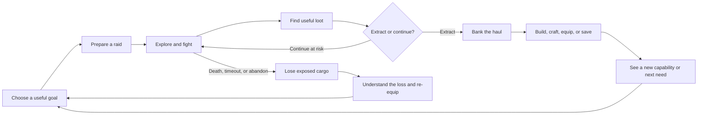

# Protocol Rebirth
## Game Design & Loop Reference

> **Go out with a purpose. Decide what is worth the risk. Come home with something that changes what you can do next.**

| Document control | Value |
| --- | --- |
| Document status | Living design reference, v1.4 - design review in progress |
| Prepared / updated | 6 November 2026 |
| Design owner | Robert Wasser |
| Audience | Game design, UX, art, engineering, production, and AI-assisted analysis |
| Repository baseline | `w4sser/protocol-rebirth-proto`, `main`, commit `88a9ac6364d0dcf5463c2a5f700f4817960ecaca` |
| Prototype version inspected | `2.28.0`; meta save version `15` |
| Scope | Current short-session PvE design and connected systems; future longer PvP/co-op directions are recorded separately, not specified as implemented modes |
| Verification | Repository documents and selected implementation/data files inspected. No new end-to-end playtest was performed for this document. |
| Subsequent owner decisions | [Design Decision Register](design-decisions.md): D1 and D2.1-D2.3 approved for the quick mode; M1 clarifies current scope and future-mode exploration; D1 details and D2.4-D2.7 remain in review |

### How to read this document

This is a consolidated explanation of the game, not a claim that every design idea has shipped. It deliberately separates six kinds of information:

- **CURRENT**: supported by inspected code or configuration at the baseline above. A data entry is not, by itself, proof that every associated UI path works.
- **DIRECTION**: recorded design intent. It may be implemented only partly.
- **APPROVED**: a decision explicitly accepted by Robert and recorded in the decision register. Approval changes the intended design; it does not prove runtime implementation.
- **PROPOSAL**: a recommendation for discussion, including adaptations of the supplied Helldivers 2 analysis. It is not an approved implementation brief.
- **OPEN**: an unresolved decision, detail, contradiction, or behavior requiring verification.
- **FUTURE EXPLORATION**: a direction the owner wants to examine later, not an approved feature specification, implementation task, or delivery commitment.

Where these differ, both are recorded rather than quietly rewriting history. Numerical values below are a snapshot, not permanent balance commitments. Follow the linked sources when changing them.

**Approved after the inspected code baseline:** D1 establishes full risk for carried and equipped gear, one Secure Slot at Vault L1, removal of BIT's automatic item rescue, removal of insurance and paid bag recovery from the core loop, and an always-available free retry. The exact Secure Slot specification and interrupted-session handling remain open. [D01]

**D2.1-D2.3 are also approved for the current quick PvE mode:** At least one return extraction is available from the beginning, and the player may extract successfully with an incomplete personal objective. Extraction starts deliberately and uses a short, cancellable countdown while the player can move, aim, and fire. Five seconds is the approved initial test value, not permanent tuning. Nodes, return topology, timer/interruption edge cases, and existing-variant mapping still require review. These approvals do not change the running game by themselves. [D01]

**M1 scope clarification:** The mode being designed now is the fast, short-session experience. Later exploration should consider longer, freer PvP extraction and longer cooperative PvE, potentially without node activation as the organizing activity. "PvE only" therefore describes the current quick mode, not an irreversible product-wide ban on future PvP. No new multiplayer mode is approved for implementation. [D01]

**Reading routes:** Read sections 1-4 for the game in one sitting. Read sections 5-12 to understand its systems. For onboarding and UX work, continue with sections 13-14 and the review register in section 18. Read the separate [Design Decision Register](design-decisions.md) for approvals and proposed details. AI tools should also read section 21.

---

## Contents

1. [The game in one page](#1-the-game-in-one-page)
2. [Design pillars and boundaries](#2-design-pillars-and-boundaries)
3. [The connected loops](#3-the-connected-loops)
4. [An ordinary raid, from intention to consequence](#4-an-ordinary-raid-from-intention-to-consequence)
5. [Combat and encounter design](#5-combat-and-encounter-design)
6. [Loot, inventory, extraction, and loss](#6-loot-inventory-extraction-and-loss)
7. [The bunker: restoration as progression](#7-the-bunker-restoration-as-progression)
8. [Economy, crafting, and trading](#8-economy-crafting-and-trading)
9. [Operator and equipment progression](#9-operator-and-equipment-progression)
10. [BIT: companion, capability, and relationship](#10-bit-companion-capability-and-relationship)
11. [World structure, objectives, and quests](#11-world-structure-objectives-and-quests)
12. [Difficulty and replayability](#12-difficulty-and-replayability)
13. [First-time player experience](#13-first-time-player-experience)
14. [UX and information architecture](#14-ux-and-information-architecture)
15. [Between-session and retention loops](#15-between-session-and-retention-loops)
16. [World, tone, art, and presentation](#16-world-tone-art-and-presentation)
17. [Lessons to adapt from the Helldivers 2 reference](#17-lessons-to-adapt-from-the-helldivers-2-reference)
18. [Decisions, contradictions, and scope boundaries](#18-decisions-contradictions-and-scope-boundaries)
19. [What a successful playtest should demonstrate](#19-what-a-successful-playtest-should-demonstrate)
20. [Glossary](#20-glossary)
21. [Source map and maintenance contract](#21-source-map-and-maintenance-contract)

---

## 1. The game in one page

**Protocol Rebirth is a landscape-mobile extraction game connected to persistent bunker restoration, currently focused on a short-session PvE mode.** The player is an operator exploring a damaged Nordic world with BIT, a small hovering CRT-faced companion. Short raids supply the materials, equipment, knowledge, and access needed to rebuild the facility and reach further into the world. Future modes are exploration directions, not existing multiplayer functionality. [S01] [S02] [S03] [D01]

The central fantasy is not simply collecting better guns. It is **turning dangerous expeditions into a place worth returning to**. A dark room becomes operational. A useful tool becomes available. BIT gains capability. A previously unreachable area becomes a plausible next expedition.

The player has two connected responsibilities:

| In the field | At home |
| --- | --- |
| Read threats, move, aim, and survive | Understand the next useful improvement |
| Find supplies that matter to a chosen goal | Spend, craft, equip, or save what came home |
| Decide which fights and detours are worthwhile | Restore the bunker and develop BIT |
| Manage limited carrying capacity and increasing pressure | Choose the purpose of the next raid |
| Extract before the risk exceeds the value | See a concrete consequence of the last raid |

### The central player question

> **"I have something useful. Is the next opportunity worth risking what I already carry?"**

That question only works when the player understands what the loot does, what is at risk, and how to get home. Confusing menus, unexplained currencies, or unclear exit conditions weaken the central decision rather than merely making the interface less attractive.

### Format and scope

**CURRENT:** The prototype is a browser-based static game, with a base/meta layer at the repository root and a Three.js raid layer in `nodspel/`. These are connected through the launch/result flow; they should not be described as two unrelated products. Progress is stored locally. The normal raid clock is eight minutes, while players may end a raid sooner by extracting. The first-time flow is a separate, shorter experience. These are baseline facts about the current prototype, not universal duration rules for future modes. [S01] [S02] [S04] [S05]

**DIRECTION FOR THE CURRENT QUICK MODE:** Accessible PvE extraction tension for a broader mobile audience, not a full military simulation. The bunker is the home and a principal motivation for taking risks. The older blanket "PvE only; no PvP" statement is qualified by M1: it still describes the present focus, but no longer rules out future PvP exploration. [S01] [S06] [D01]

### Current focus and future-mode tracks

| Track | Session and objective direction | Status |
| --- | --- | --- |
| Quick PvE raid | The current short-session experience. Nodes exist in the inspected build; their revised role remains under review. D1/D2 define the approved target risk and extraction behavior. | Current design focus; approved changes are not a claim of implementation. |
| Longer, freer PvP extraction | Later explore more player-directed sessions, with Tarkov as the owner's reference and node activation not assumed as the mandatory structure. | FUTURE EXPLORATION; player counts, squads, duration, objectives, and economy are not decided. |
| Longer cooperative PvE | Later explore extended sessions with other players against AI, potentially with different objectives and pacing from the quick mode. | FUTURE EXPLORATION; team size, revives, loot ownership, and team extraction are not decided. |

These are descriptive tracks, not approved player-facing mode names. The owner's "free for all" reference is not silently treated as a finalized deathmatch, solo-only, or squad ruleset. A shared world and systems may be useful foundations, but cross-mode progression and inventory transfer remain open. [D01]

**Not established by this baseline:** production multiplayer, a server-authoritative economy, cross-device accounts, a shared global campaign, or a released real-money business model. Do not present these as existing features.

---

## 2. Design pillars and boundaries

The following consolidates recorded direction into a common design vocabulary. It is not an instruction to add more systems.

### 2.1 Purpose before collection

A desirable improvement should create a concrete need, and that need should point toward an actionable source. "Find Cable for the Fabricator" is stronger than "Collect resources." A quest must name where an item comes from, and that source must actually support the request. [S01] [S07] [S08]

### 2.2 Risk should produce a decision

Carried loot remains exposed until extraction. Going deeper, taking a detour, replacing an item in a full bag, or bringing valuable equipment should change the player's risk calculation. Clearing a stage is not the same as banking its loot. [S04] [S05]

### 2.3 Combat should create readable problems

Movement, cover, timing, range, and flanking should matter. An encounter should be understandable before it is lethal. Tools should offer an alternative solution, not be the only way a player can pass a basic encounter. [S09] [S10]

### 2.4 Progression should be visible and useful

The player should be able to connect a reward to a changed capability: an extra bag slot, a functioning room, a different weapon behavior, a tool, or a newly accessible location. The current game includes numerical progression too; the principle is not a ban on numbers, but a demand that their benefit be legible. [S07] [S11] [S12]

### 2.5 BIT makes the loop personal

BIT is a companion, not merely a menu for bonuses. Its voice connects danger, loss, recovery, discovery, and rebuilding. Relationship progression, hardware progression, and task assignment should feel related without being confused with one another. [S03] [S13] [S14]

### 2.6 Clarity before complexity

Introduce a system when it helps the player make a meaningful decision. Explain what happened before asking for the next action. Locked content must explain its unlock path. The existence of a system does not justify putting it on the first screen. [S01] [S15]

### Boundaries to preserve

PvE remains the current quick-mode focus. M1 allows later exploration of PvP and longer co-op sessions; it does not insert them into the current implementation scope. Do not add currencies casually. BIT may perform one active assignment at a time. Design proposals that change systems, economy, or player-facing scope require an explicit decision; documenting them does not approve them. [S01] [D01]

**APPROVED D1:** Carried and equipped valuable gear is at risk. One Secure Slot unlocks at Vault L1. BIT does not automatically return lost items, and insurance/paid bag recovery are not part of the target core loop. The player can always retry with the free Basic Carbine. Precise Secure Slot eligibility, quantity, and interrupted-session behavior are not yet settled. [D01]

**APPROVED D2.1/D2.2:** Ordinary quick raids provide at least one return extraction available from the start. Personal-objective completion does not gate that return. The player must still get there and complete extraction; successful extraction does not automatically complete a quest or clear a depth. [D01]

**APPROVED D2.3:** The player deliberately starts a short, cancellable extraction countdown and remains able to move, aim, and fire within the zone. Nonlethal hits do not reset it; leaving cancels the attempt, not the raid. Five seconds is the first test value. No newly spawned extraction wave is required in that first test. This rule is scoped to the quick mode, not automatically to future multiplayer. [D01]

---

## 3. The connected loops

### 3.1 Core session loop



The diagram shows the main loss rule. The one approved Secure Slot exception is explained in section 6.4. Historical BIT rescue and insurance definitions are implementation-alignment work, not additional approved protection mechanisms. [D01]

The sequence is illustrative, not a set of mandatory exit prerequisites. Under D2.1/D2.2, the player may return with an incomplete personal goal; neither finding all required loot nor finishing every encounter is a prerequisite for the guaranteed ordinary return extraction. D2.3 defines the quick-mode departure procedure. [D01]

### 3.2 Nested loops and their jobs

| Loop | Player action | Payoff | What it contributes |
| --- | --- | --- | --- |
| Moment-to-moment combat | Read a threat, reposition, attack, recover | Survive or create an opening | Immediate play quality and mastery |
| Room/encounter | Solve a tactical problem, interact, search | Access, loot, or a cleared route | Local accomplishment and pacing |
| Raid | Pursue a purpose, weigh detours, extract | Banked materials and equipment | Risk/reward tension |
| Restoration | Track a requirement, secure parts, activate an upgrade | A functioning bunker system | Tangible persistent progress |
| Equipment | Find/craft gear, improve a build, deploy it | A different or stronger combat option | Preparation and attachment to possessions |
| Operator/BIT progression | Play, learn, develop skills and talents | Persistent capability and relationship | Continuity across success and failure |
| World progression | Improve the Core and complete scouting | New areas and objective chains | Medium-term aspiration |
| Return-session | Collect completed work and select the next goal | A useful starting point for another raid | Continuity between sessions |

**Design interpretation:** The raid supplies the bunker; the bunker gives the raid its purpose. Neither half should become a detached checklist.

### 3.3 The restoration loop in concrete terms

```text
I want the Fabricator online
  -> I need Cable, Scrap Alloy, and Scrap
  -> I know where to search
  -> I find the missing parts
  -> I choose whether to secure them now
  -> I return and activate the Fabricator
  -> I receive the Scavenger Vest and access to crafting/preparation
  -> The next raid has a visible benefit and a new purpose
```

This example uses an existing upgrade and reward, not a new tutorial item. Fabricator L1 currently costs 20 Scrap, two Cable, and two Scrap Alloy; its one-time commissioning reward is a Scavenger Vest. [S07]

### 3.4 The emotional loop

**DIRECTION / SYNTHESIS:** Curiosity -> tension -> a deliberate commitment -> relief or loss -> visible recovery/rebuilding -> renewed ambition.

Success should feel like bringing something home. Failure should create a comprehensible setback and another approach, not uncertainty about what the game did to the player's possessions.

---

## 4. An ordinary raid, from intention to consequence

This section specifies the current quick PvE track. Its approved target changes are distinguished from the older inspected build. Future modes need their own rules rather than inheriting every detail here. [D01]

### Before deployment

The player identifies a purpose: a tracked upgrade part, a quest, scouting an area, a useful weapon, or a deliberately larger haul. Available preparation draws on the player's equipment, consumables, tools, BIT capabilities, and unlocked destinations. The early flow restricts preparation before the Fabricator is online. [S07] [S11]

**UX requirement:** The preparation screen should answer three questions before exposing extra statistics: Where am I going? Why am I going? What am I putting at risk?

**APPROVED D1:** Insurance is excluded from the target core preparation loop. This is a design change to align in implementation, not a claim that the old configuration is already removed. [D01]

### During the raid

**CURRENT AT THE INSPECTED BASELINE:** The standard structure has three depths within a shared round. The player moves through spaces with enemies, cover, loot, and control nodes. In the ordinary non-Big-Map flow, all nodes on the current level must be active before its exit opens. Nodes can be interacted with through the supported shooting/proximity mechanics, with shielded variants creating additional problems. [S04] [S09]

The baseline does not automatically require killing every enemy to open an exit. Its node-gated return is recorded here as implementation history, not the newly approved future rule.

**APPROVED D2.1:** Every ordinary quick raid must offer at least one return extraction available from the beginning, without first activating the level's nodes, completing the personal objective, or clearing all enemies. The player must physically reach and complete extraction; availability does not promise safety or an instant exit. [D01]

**APPROVED D2.2:** Extracting with a partially or wholly incomplete personal objective is a successful extraction. Only the actual haul is banked. Unfinished objectives remain unfinished and receive only the progress or rewards their own conditions support. [D01]

### Approved quick-mode extraction procedure

**APPROVED D2.3:** A deliberate start followed by a short, cancellable countdown. [D01]

| Step or event | Approved behavior |
| --- | --- |
| Enter the marked zone | Show the EXTRACT action; merely walking through does not end the raid. |
| Tap EXTRACT once | Start the countdown. Five seconds is the first playtest value, not a permanently fixed balance number. |
| During the countdown | The player may move inside the zone, aim, and fire without holding an interaction button. |
| Take a nonlethal hit | Health/damage rules still apply, but the countdown is not reset. The player remains vulnerable. |
| Leave the zone | Cancel and reset the extraction attempt. The raid continues and the bag remains exposed; this is not Abandon. Returning requires another deliberate start. |
| Finish alive | Secure the actual haul and end the raid. Death before completion follows D1. |
| Enemy pressure | Existing threats may continue to attack. A new extraction-specific wave is not required in the first test, and a quiet departure is valid. |

The zone, countdown, and cancellation must be readable without sound. The first test does not add an extraction fee, a compulsory final kill count, or a forced wave. [D01]

**OPEN DETAILS:** Node roles, return topology, countdown/deadline priority, same-tick death/completion, pause/background behavior, and existing-variant mapping require explicit follow-up. Dedicated dramatic extraction encounters would be a separate choice. Do not infer that all nodes were removed or the running game was changed. Future team extraction is not specified by this single-player-oriented quick-mode contract. [D01]

**APPROVED D2.4/D2.8:** Required control nodes consistently open the **forward route** to the next part of the quick raid; they do not gate the separately available **return extraction**. The raid has an authored final stage, with better reward opportunities deeper in and a meaningful terminal objective/payoff. The exact final encounter or reward is not yet specified; a boss and an automatic full-clear bonus have not been approved. [D01]

### At a depth exit

In the inspected baseline, after an early depth, the player may extract or continue. Continuing does **not** secure the bag. The same carried value remains at risk in the next depth. The final normal depth completes the raid when the player deliberately enters the available exit. [S04] [S05]

The no-banking-on-continue rule remains approved under D1. The baseline's automatic-on-entry final extraction needs alignment with D2.3's deliberate start; it is not an additional approved exception. D2's topology review must specify how ordinary return routes work after a depth transition without silently treating the historical node gate as the target rule. [D01]

**CURRENT variant:** Big Map has separate extraction availability logic and multiple extraction definitions. It should be treated as a mode-specific structure, not assumed to follow every rule of the three-depth flow. Big Map's presence is not proof that the future longer PvP or co-op modes already exist. [S04] [D01]

### Pressure during a run

Several configured systems constrain indefinite wandering:

| Pressure | Current design/data | Intended decision |
| --- | --- | --- |
| Round clock | Eight-minute normal budget; Hard uses a shorter clock | Finish the purpose or leave before time runs out |
| Hunter waves | Alarm after 75 seconds, then waves on a 45-second cadence | Avoid treating cleared space as permanently safe |
| Healing allowance | A shared 60 HP raid healing budget | Decide when further damage exposure is no longer worthwhile |
| Carrying capacity | Base bag of four; progression can raise it, capped at ten | Prioritize what to bring home |
| Bag burden | Configured full-bag penalties up to 20% movement speed and increased detection | More value can also make leaving harder |
| Deeper encounters | Additional enemies, encounter combinations, and valuable loot | Accept greater danger for a better return |

These are baseline settings, not universal guarantees for FTUE or every mode. Waves use a fixed clock, not a separate heat mechanic. Spawn rules seek hidden, distant valid locations rather than simply placing hunters beside the player. D2.3's rejection of a compulsory new extraction wave does not remove this existing raid-pressure system. [S04] [S09] [S11] [S16] [D01]

### After the raid

Successful loot is reconciled into the persistent economy. Currency-bearing pickups convert to the relevant currency; materials and gear have different storage destinations. An unsuccessful raid records loss rather than silently treating a previous depth as a successful bank. The result should then lead back to a useful next action. [S02] [S05] [S08] [S12]

**D2.2 result contract:** Extraction outcome, personal-objective completion, and depth-clear progress are distinct facts. Early extraction must not fabricate cleared depths, completed nodes, scouting credit, or quest rewards merely to satisfy old result-ingestion assumptions. [D01]

**PROPOSAL for result-screen hierarchy:** Outcome -> what came home or was lost -> progress toward the chosen goal -> one recommended next action. Secondary XP bars should not obscure that explanation. A protected item must be shown separately from successful extraction rather than implying the entire failed raid was a success. [D01]

---

## 5. Combat and encounter design

### 5.1 Player capabilities

The player moves, aims/fires, uses cover, dashes, interacts with nodes and loot, and uses available healing or a selected tool. Weapon range, damage, firing/reload behavior, spread, and assistance create different handling profiles. Avoid deriving current input behavior from the old Node Raid README; it describes an earlier combat model. [S09] [S10] [S12]

### 5.2 Weapon identities

| Weapon | Current identity | Decision it should support |
| --- | --- | --- |
| Basic Carbine | Always-available starter; forgiving guided tracer behavior | Re-enter the loop without needing a replacement gun |
| Vector SMG | Fast fire and a larger magazine at shorter range | Maintain pressure while moving and managing proximity |
| Breach Shotgun | Short-range pellet fan and knockback | Commit to a close engagement and exploit space/control |
| Marksman Rifle | Longer range, stronger deliberate shots, slower cadence | Use sightlines and time attacks carefully |

These are existing weapon families. The document does not imply that every family is equally balanced or available during onboarding. [S12]

### 5.3 Enemies as tactical problems

The inspected encounter configuration includes the following roles:

| Encounter | What the player reads | Non-tool response | Tool-assisted response |
| --- | --- | --- | --- |
| Patrol / grunt | Detection cone or a telegraphed firing line | Avoid its view, sidestep, flank, or attack from an advantageous angle | Decoy can redirect attention |
| Front-shield guard | Protected front, slow turning, burst and recovery | Circle to the side/rear or move during recovery | Decoy can pull it away from its position |
| Sentry / turret | A firing lane and a recovery window | Use cover and advance between attacks | EMP provides an opening |
| Grenadier / thrower | A marked landing area before the blast | Leave the ring or interrupt the enemy | A tool is not required to understand the solution |
| Rusher / swarm | A charge or emerging close-range group | Sidestep, retreat, or funnel enemies through constrained space | Grenade can clear a cluster |
| Shielded node | A visible generator/shield relationship | Break the generator | EMP temporarily disables the shield |
| Locked passage | A locked direct route and an alternative | Find the keycard or take the longer route | Not every obstacle requires a tool solution |

The rows summarize configured problems, not a promise that all appear in every area. Front shields are directional; a shielded enemy should not be interpreted as invulnerable from every angle. [S09] [S10]

### 5.4 Toolkit

The current toolkit contains **Decoy**, **Grenade**, and **EMP**. The loadout supports one tool type for a raid, with limited charges; Fabricator progression and recipes supply them. Medkits are a separate consumable/kit system. [S08] [S12]

The point is to make preparation relevant without making it a test with one correct answer. A player should be able to recognize a problem in the field and understand why a different tool would have helped next time.

### 5.5 Temporary raid upgrades

**CURRENT:** Field perks are temporary, not permanent account upgrades. The configuration offers them after two room clears and includes a four-second choice timeout. Examples include Chain Reaction, Calm Reload, Rolling, Emergency Shield, Field Medic, Recon, Field Dressing, and Ricochet. [S17]

Their job is to add variation within a run. Their presentation must make their lifetime clear: **"For this raid"**, not an ambiguous upgrade that appears to persist forever. FTUE suppression and default timeout behavior should be checked in the actual flow rather than inferred from the card list.

### 5.6 Readability is part of difficulty

Telegraphs, projectile visibility, impact areas, enemy orientation, and recovery windows communicate the rules. Difficulty should come from responding to a readable problem, not from invisible attacks or contradictory cues. Existing combat data supports flanking/unaware bonuses and explicit warning behavior. [S09] [S10]

---

## 6. Loot, inventory, extraction, and loss

### 6.1 Three different places a possession can be

| State | Meaning | Risk |
| --- | --- | --- |
| At home | Persistent materials, gear, or currency already secured | Not lost merely because the next raid fails |
| Carried in the raid | Newly found materials and unequipped carried gear | Exposed until successful extraction, except the approved Secure Slot rule |
| Equipped in the raid | Selected weapon/armor and relevant carried supplies | Valuable equipment is part of the raid's risk; the basic free weapon is the fallback |

**CURRENT:** Unequipped backpack gear shares the raid's overall carrying-space constraint with materials and also has its own smaller backpack limit. Medkits use a dedicated kit count rather than ordinary material-bag slots. Encounter keycards are handled separately. [S04]

### 6.2 Home storage

The **Stash** holds materials. The **Armory** holds equipment, consumables, tools, and attachments. Their capacitiesities are separate: current data starts each at 12 slots, with Storage progression expanding them. Stack sizes are item-defined; do not equate a home-storage slot with a raid pickup. [S07] [S12]

This separation prevents a material-cleanup workflow from implicitly treating a valuable weapon as disposable clutter. It also lets preparation focus on usable gear while construction focuses on required parts.

### 6.3 What makes loot meaningful

A found item should communicate at least one actionable use: a tracked build, a recipe, a quest, a scouting unlock, a trade, equipment, or sale value. The shared `itemInfo` helper derives usage from actual module and recipe data, reducing the chance that a description promises a nonexistent use. [S08]

A full bag creates a comparison: keep the parts for today's goal, replace them with rarer future value, or extract. The interface must distinguish the amount already **HOME** from the amount still in the **BAG**.

### 6.4 Approved loss rule and remaining specification

**APPROVED D1 - Controlled Risk:** Carried and equipped valuable gear is at risk until extraction. Death, timeout, and deliberate abandonment lose exposed cargo and risked equipment. Possessions left at home and previously earned permanent progression remain intact. Advancing to another depth never banks the bag. This is the current quick-loop contract; future modes require an explicit decision about what they share or vary. [D01]

Vault / Storage L1 unlocks **one Secure Slot** as the single item-protection mechanism. BIT's automatic item rescue is removed from the intended design. Insurance and paid bag recovery are removed from the core loop. A free Basic Carbine retry must always remain possible; this does not restore the previous bag or grant free replacement armor, tools, or medkits. [D01]

**OPEN DETAILS, not a reopening of D1:** The owner has not yet finalized one unit versus a stack, allowed item categories, whether the protected item occupies ordinary bag capacity, exact in-raid selection/settlement, or interrupted-session behavior. The recommendation is one unit using ordinary capacity, with materials/ordinary valuables eligible but no equipment or dedicated mission/scouting keys. These refinements remain proposals in D1-A through D1-D, not approved facts. [D01]

**IMPLEMENTATION ALIGNMENT:** Baseline data and historical documents still contain Storage secure-slot copy, BIT Bond rescue, Guardian Safe Return, insurance, and post-death bag recovery. Audit and align their active and legacy paths with D1. Their continued presence is not an alternative approved design. No runtime removal or full end-to-end verification is claimed by this documentation change. [S07] [S11] [S13] [S14] [D01]

Persistent learning is separate from preserving loot. D1 preserves previously earned progression but does not set new XP awards for a failed run. Any protected-item result must be explicit, limited to the final eligibility rule, and reconciled exactly once.

---

## 7. The bunker: restoration as progression

The bunker is a persistent place whose systems become functional. Its progression gives meaning to otherwise generic resources. The base presentation uses staged artwork and interactive room hotspots, while raids use the separate 3D game layer. This distinction matters for implementation, not for the player's understanding of one connected world. [S02] [S07]

### Main facilities

| Facility | Role | Current progression examples and approved direction |
| --- | --- | --- |
| Rebirth Core | Power, facility access, broader progression gates | L1 restores initial power; L2 opens further access and module caps; L3 supports Town access |
| Fabricator | Crafting, recycling, and preparation | L1 awards a Scavenger Vest and basic crafting/prep; L2 provides advanced recipes and tools |
| Storage / Vault | Capacity and inventory convenience | Stash expansion, Armory expansion, additional raid carrying capability; one Secure Slot at L1 approved by D1, with its detailed specification pending |
| BIT Bay | BIT hardware and supported capabilities | Initial functionality and loot intelligence; later cargo capability |
| Living Quarters | Rest and readiness | Rest is configured to restore some bunker power and provide a shield benefit for the next raid |

Living Quarters exists in the room/access and rest systems; it should not be presented as an identical multi-level module tree to the four main module definitions. [S07] [S18] [D01]

### Separate access, construction, and benefit

A room being revealed is not the same as it being operational. A room being operational is not the same as having every later level unlocked. Likewise, a visual restoration stage and the Core's persistent power state are separate concepts in the data. UI copy should say which transition the player is making. [S07]

### A strong upgrade payoff

The Fabricator commissioning reward illustrates the intended connection: bringing the facility online awards a Scavenger Vest with **+25 shield and +1 bag slot**, ready for the next default loadout. The system also contains first-upgrade payoff configurations, such as a nearby loot cluster that makes additional carrying capacity useful. [S07] [S11]

**PROPOSAL:** Treat this as the model for important unlocks. Show what changed at home, then let the player experience its value in the next raid. Avoid awarding five unrelated systems at the same instant.

---

## 8. Economy, crafting, and trading

### 8.1 Resource vocabulary

| Resource | Role supported by the inspected data | Important distinction |
| --- | --- | --- |
| Scrap | Main soft currency for purchases, construction, crafting, and upgrades | Not the same as the material Scrap Alloy |
| Scrap Alloy | Physical construction/crafting material | Carried as an item and consumed by specific requirements |
| Data Cores | Currency used in selected progression costs and exchanges | Not the same as every item with "Core" in its name |
| Contract Chips | Quest/trade currency for the BIT catalog | Separate from Operator XP and Bond XP |
| Signals | Historical/prototype insurance, recovery, and exchange currency | D1 removes insurance/paid bag recovery from the target core loop; other uses and the eventual business model remain undecided |
| Operator XP / Bond XP | Progression measures | Not ordinary spendable currencies |
| Bunker Power / Fuel | System-specific meters | Power is a facility state; Fuel belongs to the optional retention layer |

**CURRENT:** Salvage is no longer a separate soft currency. A **Salvage Crate** remains a valid loot item and currently converts to 24 Scrap on successful ingestion. Older documents cite different conversion values; current item data is the baseline here. [S11] [S12] [S18] [S19] [D01]

### 8.2 Material families

The data groups materials into Power, Mechanical, Electronics, Bio/Medical, Protocol, and valuables/scouting items. Examples include Cable and Power Cells; Scrap Alloy, Servo, and Polymer Plate; Circuit Boards and Optical Sensors; Med Gel and Bio Samples; and AI Fragments, Encrypted Drives, Rebirth Shards, and Neural Cores. [S12]

Different materials should make destination and depth choices meaningful. Avoid inventing a universal four-tier rarity structure from an old economy proposal: the current item rarities and actual loot tables are the implementation baseline.

### 8.3 Sources and sinks

```text
Raids, quests, supported idle activities, and trading
  -> materials / currency / equipment
  -> facility upgrades / crafting / equipment improvements / trades
  -> new capacity, capability, or access
  -> new raid purposes
```

The Fabricator turns materials plus Scrap into consumables, weapons, attachments, tools, advanced components, or Data Cores through supported synthesis recipes. Recipes are gated by the relevant Fabricator level and, where applicable, unlock flags. [S08]

Examples already present include crafting the Vector SMG, Breach Shotgun, Marksman Rifle, Scavenger Vest, medkits, a Power Relay, and attachments. These are not all available at the beginning.

### 8.4 Trading and recycling

The Quartermaster sells selected common supplies and gear, buys items, and provides specific barter exchanges. Current barter examples include Servo for a Hydraulic Component and Memory Modules for a Transmitter. The vendor data does not list the SMG or shotgun as direct stock. [S19]

Selling for Scrap and breaking an item into base materials are different actions. The recycle map is deliberately lossy and excludes protected categories such as Protocol/story items; the exact allowed action should come from data, not a blanket "all junk is recyclable" assumption. [S08]

### 8.5 Monetization boundary: partly resolved, partly open

**APPROVED D1:** Insurance and paid bag recovery are excluded from the core loop. This resolves those two uses; it does not decide every other use of Signals or the eventual business model. [D01]

**OPEN:** The baseline data includes exchanging Signals for Data Cores, while earlier design language characterizes Signals as safety/time rather than power. Data Cores can participate in progression, so these statements are not automatically compatible. Treat paid progression boundaries as an open decision, not as a resolved "cosmetics-only" or "no paid advantage" promise. [S19] [S20]

---

## 9. Operator and equipment progression

### 9.1 Progression layers

| Layer | What persists | What the player understands |
| --- | --- | --- |
| Operator level | Overall raid-derived XP and level | "I am becoming more experienced." |
| Use-based skills | Mobility, Stealth, Vitality, Search, Crafting | "Doing this makes me better at it." |
| Weapon mastery | Weapon-use/kill-based mastery progression | "I know this weapon better." |
| Equipment build | Upgrade levels, Mk tier, fitted attachments on the relevant built copy | "This is a valuable piece of gear I prepared." |
| Bunker and area unlocks | Operational facilities and access | "My home and available expeditions have expanded." |
| BIT | Bond, hardware, and talents | "My companion is growing with me." |
| Raid perks | Nothing beyond the current run | "This raid has a particular temporary build." |

The distinction between persistent character development, a losable item build, and temporary perks must remain explicit. [S02] [S11] [S14] [S17]

### 9.2 Operator development

**CURRENT data:** Operator progression is configured up to level 30. Use-based skills include Mobility through movement/dashing, Stealth through close node interaction, Vitality through damage/healing/survival, Search through searching containers, and Crafting through crafting/extracted items. Weapon mastery uses kill thresholds and modifies handling. [S11]

The current design is therefore a mixture of automatic numerical development and explicit preparation choices. It is not purely horizontal progression.

### 9.3 Equipment development

The equipment model includes incremental upgrades, Mk tiers, and attachments. Barrel, magazine, and optic attachments create visible range, capacity, or damage changes, with tier requirements. The art data also distinguishes visual grades: Salvaged, Restored, Custom, and Svartverk. The last is a configured visual grade, not automatically an independent fourth merge tier. [S11] [S12]

**Important implementation detail:** The current save-model comments describe tier, attachments, and upgrade level as belonging to a built copy. Older comments describing permanent per-item-ID upgrades must not be used to promise that a lost upgraded gun returns with its investment intact. D1 confirms that valuable deployed equipment is at risk, not automatically rebuilt after failure. [S02] [D01]

**OPEN:** Merge documentation describes a universal three-copy rule, while current configuration uses `copies: [3, 7]`. Use the live merge logic and UI when explaining the exact requirement; do not reproduce the obsolete rule as settled design. [S06] [S11]

### 9.4 Progression should widen useful choices

**PROPOSAL:** Review each major upgrade against two questions: What can the player do differently? Where will they notice it immediately? Preserve satisfying numerical growth, but prioritize new tactical options, carrying decisions, and access over layers of nearly invisible percentage bonuses.

---

## 10. BIT: companion, capability, and relationship

BIT is the emotional connection between the hostile field and the recovering bunker. Its established tone is helpful, loyal, dry, and slightly cheeky. It comments on discoveries, death, returning home, completed construction, and the player's next need. [S03] [S13]

### Four systems that should not be conflated

| BIT layer | Purpose | Current evidence |
| --- | --- | --- |
| Character/presentation | Make the journey feel shared | Contextual dialogue and a fixed CRT-faced identity |
| Bay hardware | Improve physical capability | BIT Bay module levels and cargo/scan-related benefits |
| Bond | Represent accumulated relationship/experience | Bond thresholds, raid XP sources, and a configured cap of 20 |
| Talent tree | Let the player specialize | Scout, Guardian, and Scavenger branches with ranks, row gates, choices, and capstones |

Early narrative presence does not mean every Bay hardware function is already unlocked. Likewise, Bond level, Bay level, and Operator level are not three names for the same progression bar. [S07] [S13] [S14]

### Talent identities

**Scout** supports information and finding useful loot. **Guardian** supports survival and defensive capability. **Scavenger** supports the home economy and scavenging. The configured tree includes mutually exclusive choices on some rows as well as passive effects. [S14]

**APPROVED D1:** Automatic item rescue is no longer part of the intended BIT design. Existing Bond rescue and Guardian Safe Return must not remain as additional death-protection paths beside the Secure Slot. Their removal or replacement needs an implementation plan; the exact replacement talent is not approved here. This does not remove pre-loss support such as warnings or shields. [D01]

The newer talent data explicitly replaces the older single-active-skill toggle for the core skills: learned nodes become passive. This does **not** overturn the separate rule that BIT can perform only one active assignment at a time. [S01] [S14]

### BIT assignments

Scavenging, a longer expedition, and accompanying/supporting a raid represent opportunity costs. A companion away on an assignment should not simultaneously provide every field benefit. The exact availability rules should remain visible rather than requiring the player to infer them from missing bonuses. [S01] [S18]

**PROPOSAL for guidance:** BIT should identify a need, point to a useful source, acknowledge a meaningful find, and explain a consequence. It should not narrate every pickup or compete with urgent combat information.

---

## 11. World structure, objectives, and quests

### 11.1 World progression

The configured world-map order is **Bunker -> Archipelago -> Town**. A new area's access combines Core progression with a successful scouting extraction. [S11]

| Area | Identity | Configured access |
| --- | --- | --- |
| Bunker | Facility interiors, constrained routes, initial encounters | Starting area |
| Archipelago | Islands, piers, rocky shores, patrols | Core L2 plus an extracted Archipelago Chart from the Bunker |
| Town | Abandoned settlement, searchable houses, harder encounters | Core L3 plus an extracted Town Survey from the Archipelago |

This makes exploration itself part of progression: the player does not unlock every destination merely by accumulating a generic account level.

### 11.2 Keep objective types distinct

A raid can contain several different reasons to act:

| Objective type | Example | What completes it |
| --- | --- | --- |
| Return extraction | Under approved D2.1, at least one ordinary quick-mode return route is available from the start | Reach and complete D2.3's extraction procedure; personal-goal completion is not required. The inspected baseline's node gate needs alignment. |
| Personal build goal | Find Cable for a facility upgrade | Bring home enough usable materials and perform the build |
| Quest | Extract specified items, defeat a specified enemy, or hand in parts | Meet that quest's own objective and claim/hand in as required |
| Optional opportunity | Extra cache, equipment pickup, searchable room | Take the opportunity and, for exposed carried rewards, extract |
| Scouting goal | Recover a chart/survey | Extract the relevant scouting item under the baseline rule |

**APPROVED D2.2:** Personal-goal completion and successful extraction are independent. The player may leave successfully with an incomplete goal; the missing requirement does not become completed merely because the player got home. [D01]

**PROPOSAL:** Present these as a hierarchy, not five competing primary missions. The player needs to know both why they entered the raid and how to get home. The exact HUD hierarchy and revised node functions remain under review. Node activation is not established as a requirement for future longer modes. [D01]

### 11.3 Quest systems

**CURRENT configuration:** Generated BIT quests draw from reachable world facts and cover kills, searches, extraction, or clears. The data sets three per day, one free swap, and a choice of rewards. Permanent quest chains separately provide ordered area progression, named steps, material hand-ins, and unlocks. [S21]

The configured Bunker chain is **Wake the Core**. The Archipelago chain is **Signals at Sea**. Rewards include materials, tools, Scrap, XP, Contract Chips, recipes, cosmetics, and Hard access. There is not an equivalent authored Town chain in the inspected quest-chain table; do not invent one to make the presentation symmetrical. [S21]

Contract Chips feed BIT's catalog of recipe access, selected materials, Hard passes, and cosmetic looks. A weekly-operation reward table is explicitly a stub: the weekly operation should not be described as implemented. The catalog also mentions items such as the Gull Drone blueprint; catalog presence alone does not prove a complete playable drone system. [S21]

---

## 12. Difficulty and replayability

The game varies through seeded layouts, area identity, depth, encounter combinations, loot, weapon/tool selection, and temporary perks. Hard variants remix existing spaces with more demanding settings and rewards, rather than constituting an entirely separate world. [S09] [S17]

### Readable challenge, not invisible punishment

The intended encounter contract preserves warnings and alternative tactical responses. More enemies, stronger combinations, and reduced time can create pressure without making cues unreliable. Preparation should help, but the player should still understand how to respond after an imperfect loadout choice.

### Adaptive difficulty

**CURRENT code:** A between-raid adaptive difficulty system uses recent outcomes and combat/performance signals to adjust bounded parameters for later raid generation. It does not claim to change those parameters in the middle of a fight. It requires repeated signals before shifting and treats the early FTUE separately. [S22]

The source contains target extraction bands, but those are tuning inputs, not measured player retention or proof of a good experience. Its storage key is also currently shared rather than save-slot namespaced, which matters when comparing fresh profiles on one device.

### Replayability test

**PROPOSAL:** A repeated raid should provide at least one changed reason to play: a new purpose, a different route, a meaningful loadout choice, a different encounter decision, a desirable haul, or a useful upgrade payoff. Changing only the seed is not sufficient evidence of meaningful variation.

---

## 13. First-time player experience

### 13.1 The problem to solve

The supplied team feedback is that too much is introduced without explanation. The repository's FTUE audit similarly describes multiple pre-combat screens and competing goals. These are reasons to investigate comprehension, not proof that every new player fails every step. [S15]

The onboarding goal is not to teach the entire system inventory. It is to establish one complete, memorable loop:

> **Act -> find something useful -> get out -> make home better -> understand why to go again.**

### 13.2 Current direction and implementation evidence

The older opening-playtest guide begins at the base with the Core. A later FTUE decision instead prioritizes immediate shooting and moves the cold open to after the first extraction. These are different historical flows, not steps to concatenate. [S15] [S23]

**DIRECTION recorded in the FTUE document:** The first attempt has real risk. A failed attempt leads to an easier second attempt, followed by a strongly assisted third attempt. Important guidance must also work without sound. [S15]

**CURRENT code/data:** The direct-raid FTUE has a fixed pair of initial grunt positions, an assistance ramp, and a clutch sequence that adds two hunters once the nodes are active. The third assistance setting includes minimum-health and minimum-time protection. Its ten-second clutch countdown creates pressure but explicitly does not close the beam or independently end the raid. [S24] [S25]

The FTUE design document's final implementation-status paragraph is older than some of this code. Treat the code as evidence that these pieces exist, while still verifying the full fresh-save experience on a device.

**D1 boundary:** The Secure Slot unlock remains Vault L1. Do not quietly grant a second item-rescue system before that upgrade. D1 does not by itself overturn the separately recorded FTUE assistance direction. [D01]

**D2.3 alignment:** The historical FTUE pressure countdown is not the newly approved five-second extraction procedure. D2.7 must explicitly reconcile FTUE teaching and any scripted encounter with the quick-mode contract. This update neither changes the running tutorial nor automatically approves an exception or a replacement hunter sequence. [D01]

### 13.3 Intended learning sequence

This is a consolidated design sequence, not a frame-by-frame claim about the current UI.

| Stage | Player experience | What should be learned | What should wait |
| --- | --- | --- | --- |
| First contact | Move, aim/fire, encounter an obvious threat | "I can control this, and attacks can be read." | Full equipment statistics and economy |
| First useful find | Recognize and collect supplies | "This is worth taking home." | Every item family and crafting recipe |
| First extraction | Reach the available exit under readable pressure | "Finding is not keeping; getting home matters." | Multiple competing quest systems |
| First home payoff | Restore power and understand the next useful facility | "My raid changes this place." | All long-term currencies and upgrade trees |
| First preparation | Use a relevant piece of equipment or benefit | "What I built affects my next attempt." | Advanced optimization |
| First independent choice | Choose a goal or decide to push further | "I am making my own risk/reward decision." | Optional retention and commerce experiments |

### 13.4 Targets, not measured achievements

The FTUE design proposes first shot in under 15 seconds and first extraction in under 90 seconds. These are targets from the design document, not results established by this review. The more important comprehension checks are whether the player knows their purpose, recognizes what they gained, and voluntarily chooses another raid. [S15]

**PROPOSAL:** Reveal systems by demonstrated relevance. Do not simply replace eight opening screens with an eight-screen tutorial after extraction.

---

## 14. UX and information architecture

### 14.1 Information hierarchy

The raid should prioritize immediate danger, the current actionable objective, and the path/rules for extraction. Bag value and progress toward a tracked goal should support decisions without covering the playfield. Temporary offers must not obscure an urgent attack. [S01] [S03]

At home, prioritize the next useful improvement and its benefit. At the Fabricator, show craftable outputs and missing inputs. In the Armory, show usable equipment and meaningful comparisons. On BIT screens, distinguish Bond, talents, and assignment availability.

### 14.2 Screen responsibilities

| Surface | Primary question |
| --- | --- |
| Base | What should I restore or improve next, and why? |
| Room detail | What does this room do, and what changes at the next level? |
| World map | Where can I go, what is there, and what unlocks the next area? |
| Raid preparation | What is my purpose and what am I taking/risking? |
| Raid HUD | What requires action now? |
| Loot comparison | Why would I take this instead of what I already carry? |
| Raid result | What did I secure or lose, and what can I do with the outcome? |
| Armory / equipment | What does this item let me do, and what improvement is available? |
| BIT | What has BIT learned, what can it do, and is it available? |

This table is a responsibility model, not a requirement to add new screens.

### 14.3 Reveal information where it is used

The armory/UI design calls for contextual currency presentation instead of showing all counters everywhere. Apply the same logic to mechanics: show a missing part beside the build it serves; explain a stat beside the choice it changes; show a locked area's actual requirements beside that area. [S06]

**PROPOSAL:** Every introduced system should have four explicit answers: What is it? Why should I care now? What action can I take? How will I recognize the outcome?

### 14.4 Existing presentation constraints

Keep controls within the safe area, preserve a full-bleed playfield, use shared popup components, keep notices unobtrusive, and use bespoke icons rather than emoji. The art direction prioritizes player/BIT/immediate threats, then routes and boundaries, then cover/objectives, then atmosphere. [S01] [S03]

---

## 15. Between-session and retention loops

### 15.1 Always-on idle systems in the data

The current idle configuration is separate from the optional retention-mode experiment. It includes a Core Scrap generator, construction timers, a sequential Fabricator queue, BIT scavenging, and a welcome-back summary. The first eligible higher-level build and first craft have instant-completion exceptions to preserve early momentum. [S18]

These systems should return the player to a useful raid purpose: a craft completed, an upgrade is ready, or a missing-material gap has narrowed.

### 15.2 Optional retention modes

| Mode | Configured role in the inspected baseline |
| --- | --- |
| `core` | Default; test the base loop without the optional retention package |
| `bit` | Adds the Morning Report and BIT expeditions |
| `full` | Adds Fuel, additional daily contracts, decryption, streak, and overnight-yield features |

Do not confuse these optional daily contracts with the separately configured BIT quests and permanent quest chains. They are different systems with overlapping terminology. Retention-mode switches are also not the future PvP/co-op game modes described by M1. [S18] [S21] [D01]

**APPROVED D1 constraint:** Whatever optional retention mode is enabled in the current quick experience, the free starter retry must remain available. Any Fuel/payment/wait restriction that blocks it must be reconciled. Insurance and paid bag recovery must not reappear as a hidden exception to the target core loop. The retained baseline table is not approval of every experimental feature. [D01]

### 15.3 Power and rest

Bunker Power is a separate urgency/maintenance meter. It drains mildly, has a capped offline drain, and supports reinforcement or a Cable hand-in. Low power can affect non-Core room availability; the design copy preserves the ability to raid. Living Quarters rest provides configured power recovery and a next-raid shield benefit. [S07] [S13] [S18]

**Design risk to review:** Power, Fuel, construction, crafting, scavenging, quests, and a Morning Report can collectively turn a simple return into administrative work. Their combined cost must be tested, not assessed one feature at a time.

### 15.4 Desired reason to return

**PROPOSAL:** Lead with anticipation of a useful expedition or a meaningful restoration payoff. Timers and reminders should support that motivation rather than substitute for an enjoyable raid. Do not add more retention layers until the unadorned loop makes players choose another run.

---

## 16. World, tone, art, and presentation

### 16.1 Tone and setting

**DIRECTION:** "Dark, but never hopeless." A damaged world can still be alive, beautiful, and worth rebuilding. Nordic melancholy sits beside human warmth, rather than generic dystopian horror. [S03]

The contrast is **soft nature and hard engineering**: asymmetrical vegetation and rock against deliberate Cold War concrete and machinery. Swedish identity should come through the landscape and built environment, not national flags.

The operator is an adult, slender, hooded figure rather than a cute/chibi hero. BIT's friendly CRT face and distinctive body are locked visual assets, not invitations to invent a different smile for each use. [S03]

### 16.2 Readability and color

| Signal | Meaning |
| --- | --- |
| Cyan | BIT, powered systems, extraction |
| Amber | Loot, human warmth, optional opportunity/value |
| Coral / danger red | Hostile sensing and confirmed danger |
| Neutral contrast | Player separation and readable walkable space |

The primary UI action also has its own tokenized treatment. Color is semantic, not decoration. Large forms, controlled density, and clear silhouettes should survive phone-scale viewing. [S01] [S03]

### 16.3 Narrative through action

The existing premise connects the operator, BIT, a dead facility, and the possibility of restoring it. Protocol fragments add mystery through decryption in the optional layer. The inspected sources do not define a complete ending, final antagonist, or fully authored campaign; those must remain unspecified here. [S11] [S18]

**PROPOSAL:** Let turning on a room, reaching a new coastline, recovering a signal, or discovering a useful machine carry story significance. Personal visible restoration can deliver a larger purpose before any shared-world live-service system exists.

### 16.4 Audio and silent play

BIT's established dialogue tone should remain consistent across base and raid. Important guidance cannot depend on hearing a voice line; the recorded FTUE decision explicitly requires critical information on screen as well. Music and atmosphere should support the world's restrained, hopeful mood without masking actionable combat information. The latter is a presentation recommendation, not a new audio implementation claim. [S13] [S15]

---

## 17. Lessons to adapt from the Helldivers 2 reference

**Status: PROPOSAL.** This section interprets the video and transcript supplied for the design discussion. It is not an independent verification of Helldivers 2's current mechanics, and it does not silently replace Protocol Rebirth's existing rules.

| Reference principle | Adaptation for Protocol Rebirth | Boundary |
| --- | --- | --- |
| Clear primary objective, optional secondary work, uncertain discoveries | Establish one understandable purpose, then offer optional opportunities around it | Do not turn a short mobile raid into a long checklist |
| A visible mission/reward/upgrade loop | Connect the haul to a specific bunker or equipment payoff | Avoid rewards that lack an understandable use |
| Enemies create pressure, not just farming opportunities | Make routing, avoidance, timing, and extraction worthwhile decisions | Current kills contribute to other systems; removing those rewards is a separate design change |
| Big, perceivable capability choices | Favor noticeable tools, weapon identities, capacity, and access | Do not falsely describe the existing numerical progression as absent |
| Preparation near the moment it matters | Explain and offer equipment choices when there is an actual mission context | Do not teach the whole loadout system before the player has experienced combat |
| Progression through participation and efficiency | Preserve a recoverable path and useful progress after setbacks | Do not erase the meaning of extraction loss |
| Player-favoring clarity and recoverability | Make warnings, consequences, and return paths understandable | Generosity is not the same as guaranteeing every raid succeeds |
| Participation in a larger purpose | Use visible bunker/world restoration as the near-term purpose | A global campaign is not required for the current slice |
| Spending that feels supportive | Define business-model boundaries deliberately before implementation | D1 excludes insurance and paid bag recovery from the core loop; broader business-model questions remain open |

The video's respawn resources, friendly fire, shared loot, and stratagem input sequences belong to its particular cooperative design. They are not automatic recommendations for this game. Especially in an extraction game with losable gear, copying an isolated punishment mechanic without its surrounding recovery system would be a different design.

**Reference timestamps:** core loop 1:13-2:26; mission structure 2:36-5:30; death/friendly fire 5:35-8:43; enemy rewards and shared loot 8:50-10:34; distinct input/decision rhythm 10:40-12:24; progression 12:50-17:04; broader campaign and spending 17:09-20:59. [V01]

---

## 18. Decisions, contradictions, and scope boundaries

This is a review register, not permission to implement every item. Explicit approvals and proposed refinements are recorded in the [Design Decision Register](design-decisions.md). [D01]

| Priority | Topic | Status / evidence | Required outcome |
| --- | --- | --- | --- |
| P0 | Death and protection | D1 direction APPROVED: full risk, one Vault L1 Secure Slot, no BIT auto-rescue, no insurance/paid bag recovery, free retry | Finalize D1-A through D1-D and align runtime paths, migration, and UI; do not reopen the five approved rules by treating old code as design authority |
| P0 | Mission purpose and exits | D2.1-D2.3 APPROVED for quick PvE: return available from start, incomplete goals allowed, deliberate cancellable extraction; five seconds is initial test tuning | Align the old node-gated/automatic-entry implementation; resolve timer/interruption edges and D2.4-D2.7 nodes, topology, communication, and existing-variant mapping |
| P0 | Current onboarding | Base-first playtest guide vs later direct-raid FTUE and newer assist/clutch code | One canonical fresh-save journey; label the older route explicitly and reconcile it with the approved quick-mode extraction |
| P0 | Competing goals | Nodes, tracked build, quests, and extraction can all demand attention | One visible objective hierarchy; distinguish purpose from mandatory exit conditions |
| P0 | First upgrade payoff | Existing Fabricator/Vest reward vs multiple simultaneous systems | Show what changed and make it useful in the next raid |
| P1 | BIT system overlap | Older single-active-skill copy vs passive talent tree vs one active assignment; rescue conflicts resolved in direction by D1 | Explain Bond, hardware, talents, and assignments separately; remove/refactor item-rescue effects without adding a second protection route |
| P1 | Equipment persistence | Older per-item upgrade descriptions vs built-copy save semantics; D1 confirms deployed valuable gear is risked | Clearly state what is lost with a particular item |
| P1 | Merge requirements | Three-copy prose vs `[3, 7]` configuration | Verify live behavior and update old descriptions |
| P1 | Bag expansion | Module copy and progression mapping are not perfectly aligned; Secure Slot capacity detail still open | Show the actual computed capacity and each contributing source |
| P1 | Retention layering | Idle/power systems plus optional Fuel/contracts/report systems | Decide default exposure; preserve D1's free retry regardless of optional retention systems |
| P1 | Commerce boundaries | D1 excludes insurance/paid bag recovery; Signals-to-Data-Cores exchange and wider policy remain open | Explicit policy before any real-money release |
| P2 | Future game modes | M1: current mode is quick PvE; longer, freer PvP and co-op PvE are requested exploration tracks | Define separate mode contracts later; do not universalize nodes, timers, inventory transfer, or team rules |
| P2 | Catalog placeholders | Weekly operation stub and blueprint/catalog references | Separate visible promises from complete playable functionality |
| P2 | Old technical documentation | Node Raid README and integration history describe superseded states; older global PvE-only wording is qualified by M1 | Point readers here for the baseline and approved scope; retain history without presenting it as current authority |

### Future scope, not current baseline

**M1 - owner-requested exploration:** The current mode is the quick experience. Later, examine longer, freer PvP extraction with Tarkov as a reference and longer cooperative PvE sessions. Those modes may use objectives other than activating nodes. The owner has not fixed durations, player/team counts, objective structures, or delivery timing. "Free for all" does not settle deathmatch versus extraction, solo versus squads, or the presence of AI. [D01]

The world, bunker, BIT, combat, and extraction identity may provide common foundations, but shared progression, cross-mode inventory, reward rates, and loss/protection variations remain undecided. A later mode review must define these alongside revives, loot ownership, team extraction, and interruption handling. Do not quietly allow easy-mode rewards to transfer into another mode, or prohibit such transfer, without deciding the intended relationship. [D01]

This clarification means "PvE only" remains a current quick-mode constraint, not a permanent product-wide prohibition. It does not authorize PvP implementation, matchmaking, networking, a mode menu, or a parallel build. Low-friction joining has been discussed previously, but no production multiplayer behavior is established by this reference. [D01]

A backend/account system is also described as future work in the agent guide. The current design reference must not assume cloud saves, server-authoritative results, social progression, or a global campaign already exist. [S01]

### What this document does not approve

D1 approves the five specified risk/recovery rules for the loop under review. D2.1-D2.3 approve the quick mode's available return, independent personal-goal completion, and deliberate short extraction procedure. Five seconds is an approved initial test value, not permanent tuning. M1 records current scope and future exploration, not additional game-mode implementation. None of these approvals automatically authorizes a gameplay commit or merge. D1 specification recommendations, D2.3's remaining edge cases, and D2.5-D2.7 and final-payoff specifics remain open. [D01]

No new currencies, replacement economy, guaranteed success outside the defined FTUE assistance, removal of kill rewards, Helldivers-style friendly fire, broader monetization, or combat rewrite is authorized here. The purpose is a shared understanding from which scoped decisions can be made.

---

## 19. What a successful playtest should demonstrate

These are proposed validation questions. They are not measured outcomes of this documentation task.

### Comprehension

After an uncoached first complete loop, ask the player to explain what they were trying to achieve, what they brought home, what would have been lost on failure, what changed at the base, and why they might play another raid. A correct code path is not evidence that the player understood it. [S23]

### Decision quality

Observe whether the player makes a deliberate extraction/continue choice, recognizes an optional opportunity, uses an enemy's tell to change behavior, and selects or values equipment for a reason. Distinguish "I chose not to fight" from "I never noticed the enemy" and "I chose to leave" from "I could not find anything else."

### Suggested measures

| Measure | Definition |
| --- | --- |
| Time to first shot | First valid shot minus first PLAY action, on a genuinely fresh profile |
| Time to first extraction | First successful extraction minus first PLAY action; record attempts separately |
| First-loop completion | New profiles that extract and perform the intended first home payoff |
| Second-raid initiation | Players who voluntarily launch the next raid after seeing the first payoff |
| Goal comprehension | Player can name the active purpose and expected benefit without coaching |
| Risk comprehension | Player can distinguish home inventory, carried value, and relevant protection rules |
| Upgrade comprehension | Player can identify what an upgrade changes in actual play |
| Decision diversity | Different informed approaches are observed, not merely different button presses |

The prototype contains local FTUE timestamps and an event log, including a `ONE_MORE_RAID` concept in its documentation. Audit event definitions before treating them as a complete analytics funnel. No production retention percentages are asserted here. [S26] [S15]

**Recommended first review:** Inspect one fresh-save journey and one returning-player journey. For each interruption, record the triggering system, the decision it enables, whether the player needs it now, and what can be deferred without removing useful agency.

---

## 20. Glossary

| Term | Meaning in this document |
| --- | --- |
| Raid | One launched field run ending in extraction or loss; not a synonym for a single room |
| Quick mode / Quick Raid | Descriptive working label for the current short-session PvE experience, not an approved marketing name |
| Future mode | A separately reviewed ruleset; longer PvP/co-op tracks are exploration directions, not shipped features |
| Depth / level | A stage inside the normal quick raid; not Operator level |
| Area | Bunker, Archipelago, or Town on the world map |
| Node | A control objective involved in opening exits in the inspected baseline; its quick-mode role is under D2.4 review and cannot block the guaranteed ordinary return route; not universal to future modes |
| Extraction | The successful act that banks the exposed carried haul; not automatic personal-objective or depth completion |
| Secure Slot | The one item-protection mechanism approved at Vault L1; quantity, eligibility, and settlement details remain under review |
| HOME | Already secured persistent possessions |
| BAG | Exposed raid cargo except any explicitly protected item |
| Stash | Home storage for materials |
| Armory | Home storage for equipment and related usable items |
| Scrap | Soft currency |
| Scrap Alloy | A physical material, not Scrap currency |
| Rebirth Core | The central bunker facility |
| Data Cores | A progression-related currency |
| Operator level | Overall player progression |
| BIT Bond | Relationship/experience progression with BIT |
| BIT Bay | The companion's hardware facility |
| BIT talent | A learned specialization effect; not the same as an assignment |
| BIT assignment | Work that occupies BIT, subject to the one-active-task rule |
| Mk tier | Equipment build tier, separate from its incremental upgrade level |
| Field perk | A temporary modifier for the current raid |
| FTUE | First-time user experience: the introduction to play and the core loop |
| DDA | Dynamic difficulty adjustment applied to subsequent raid generation |
| Retention mode | A developer-configured experimental layer, not a difficulty setting or the future PvP/co-op game modes |

---

## 21. Source map and maintenance contract

### 21.1 Source hierarchy

For **what the build currently does**, prioritize inspected behavior and current implementation over old prose. For **what the game is intended to become**, prioritize explicit owner decisions and approved direction. The separate decision register records approvals made after the inspected baseline. Code is not automatic design approval, and an old proposal is not implementation evidence.

Implementation and historical-document links below are pinned to the inspected commit. This prevents the document's evidence silently changing underneath a review. Update the baseline and relevant claims together when refreshing it. D01 is intentionally a relative link to the living decision register in the same branch: its approvals are not claims about that older code snapshot.

### 21.2 Sources

| ID | Source | Used for |
| --- | --- | --- |
| D01 | [Design Decision Register][D01] | Owner-approved D1, D2.1-D2.3, M1 scope clarification and future exploration; outstanding details and no gameplay implementation implied |
| S01 | [Agent guide][S01] | Product direction, UI constraints, future backend boundary; its broad PvE-only wording is qualified by later owner clarification M1 |
| S02 | [Base application][S02] | Current app/save versions, persistent state, FTUE instrumentation, built-copy comments |
| S03 | [Art direction][S03] | Tone, setting, character identity, visual priorities, color semantics |
| S04 | [Raid round logic][S04] | Clock, inventory, terminal outcomes, extraction versus continuation, FTUE/Big-Map branches |
| S05 | [Meta/core integration history][S05] | Connected-loop contract and later explicit extraction/loss decisions; earlier sections are historical |
| S06 | [Armory design][S06] | Gear/stock separation and contextual UI intent; proposal-era numbers require current-code checks |
| S07 | [Facility data][S07] | Module requirements and benefits, storage capacities, room/access structure |
| S08 | [Recipes and item-use helpers][S08] | Crafting, recycling, material uses, displayable item purpose |
| S09 | [Raid level rules][S09] | Normal depths, nodes, encounters, alternate solutions, Hard settings |
| S10 | [Combat tuning][S10] | Telegraphs, weak-side bonuses, assistance-related settings |
| S11 | [Progression data][S11] | Starter state, bag progression, skills, Operator/mastery, world access, gear tiers and art |
| S12 | [Item data][S12] | Weapons, armor, materials, tool definitions, currency-bearing loot |
| S13 | [BIT data][S13] | Bond, dialogue, older skill definitions, rescue-related copy |
| S14 | [BIT talent data][S14] | Current branch structure, passive-core replacement, protection talent definitions |
| S15 | [FTUE design and decisions][S15] | Audit, direct-raid direction, owner decisions, target timings |
| S16 | [Raid stakes tuning][S16] | Healing budget, hunter cadence, spawn constraints, bag burden |
| S17 | [Raid perk data][S17] | Temporary upgrades, room-clear trigger, choice timer |
| S18 | [Retention, idle, power, and rest data][S18] | Mode distinctions, offline systems, facility maintenance, rest |
| S19 | [Vendor data][S19] | Stock, barter, currency exchanges, monetization tension |
| S20 | [Economy design history][S20] | Original proposals and later owner decisions; not a single current spec |
| S21 | [Quest and chip-shop data][S21] | Generated quests, authored chains, catalog, explicitly stubbed weekly operation |
| S22 | [Adaptive difficulty][S22] | Between-raid adaptation and local storage limitation |
| S23 | [Opening playtest guide][S23] | Earlier complete-loop route and comprehension-validation questions |
| S24 | [FTUE raid logic][S24] | Fixed opening enemies, clutch sequence, countdown semantics |
| S25 | [FTUE assistance data][S25] | Attempts and assistance settings |
| S26 | [Repository README][S26] | Connected raid entry point and documented event-log concepts; onboarding/save prose is historical |
| V01 | [Supplied Helldivers 2 design video][V01] | External design inspiration, interpreted from the supplied transcript/screenshots |

The user's supplied feedback and design discussion motivate the review questions and proposed adaptations. They are not substituted for current repository behavior.

### 21.3 Maintenance rules

When a change alters a player-facing loop, update the relevant section in the same PR or link the documentation follow-up. State whether the change is approved direction, implemented behavior, an experiment, or a proposal. Once a direction is decided, mark the former design conflict as resolved and separately track any remaining implementation mismatch or specification detail.

Keep exact balance tables in their source data. This reference should explain the job of the system and only repeat selected numbers that materially help a reader understand it. Documentation-only updates should not silently change runtime behavior or balance. Never relabel an approved rule as CURRENT until implementation evidence supports it.

State the applicable mode whenever a rule depends on session length, node objectives, team structure, extraction, or reward transfer. Do not turn current quick-mode behavior into a universal product restriction, or turn future exploration into an implementation commitment. [D01]

### 21.4 Instructions for AI-assisted use

Use this document as the navigation layer, then inspect the linked implementation for the question being asked. Preserve the status labels and read D01 for post-baseline approvals. Never turn a proposal, a catalog entry, a stale comment, an approved-but-unimplemented rule, a future-mode idea, or a configured-but-unverified path into a shipped feature. When a source conflicts with this reference, report the conflict and the baseline involved rather than inventing a reconciliation.

Useful questions include: "What must a new player understand before their first extraction?", "Which permanent systems currently interrupt the first raid?", "What does this upgrade change in the next run?", and "Which source defines the actual death behavior for this mode?"

### Document change log

- **v1.4, 6 November 2026:** Approved D2.4 (required nodes consistently unlock forward progression, separate from return extraction) and D2.8 (deeper loot opportunities plus a distinct valuable terminal objective/payoff, option C). Preserved open reward/encounter tuning, topology, and FTUE questions. Documentation only.
- **v1.0, 6 November 2026:** Consolidated the game's loops and system model, separated current evidence from direction/proposals, and recorded unresolved documentation conflicts.
- **v1.1, 6 November 2026:** Recorded owner-approved Controlled Risk decision D1, linked the decision register, reconciled the loss/BIT/insurance/free-retry direction across relevant sections, and opened D2 as an explicitly unapproved proposal. Secure Slot details and interrupted-session behavior remain open. No gameplay change or fresh runtime validation is implied.
- **v1.2, 6 November 2026:** Recorded D2.1/D2.2 approval: at least one ordinary return extraction available from the start, with extraction success independent of personal-objective completion. Updated the loop, objective, result, glossary, and review sections while retaining the older node-gated behavior as the inspected baseline. D1 details, D2.3's countdown proposal, and D2.4-D2.7 remain open. Documentation only; no gameplay change or new runtime verification.
- **v1.3, 6 November 2026:** Recorded D2.3 approval for deliberate, short, cancellable quick-mode extraction, with five seconds as initial test tuning. Added M1: the current focus is the quick PvE experience, while longer, freer PvP and cooperative PvE are future exploration. Qualified the older global PvE-only wording, separated mode scope from common systems, and left multiplayer/transfer rules unspecified. D1 details, D2.3 edge cases, and D2.4-D2.7 remain open. No gameplay implementation or new runtime verification.

[D01]: design-decisions.md
[S01]: https://github.com/w4sser/protocol-rebirth-proto/blob/88a9ac6364d0dcf5463c2a5f700f4817960ecaca/AGENTS.md
[S02]: https://github.com/w4sser/protocol-rebirth-proto/blob/88a9ac6364d0dcf5463c2a5f700f4817960ecaca/app.js
[S03]: https://github.com/w4sser/protocol-rebirth-proto/blob/88a9ac6364d0dcf5463c2a5f700f4817960ecaca/docs/art-direction.md
[S04]: https://github.com/w4sser/protocol-rebirth-proto/blob/88a9ac6364d0dcf5463c2a5f700f4817960ecaca/nodspel/round.js
[S05]: https://github.com/w4sser/protocol-rebirth-proto/blob/88a9ac6364d0dcf5463c2a5f700f4817960ecaca/docs/meta-core-integration.md
[S06]: https://github.com/w4sser/protocol-rebirth-proto/blob/88a9ac6364d0dcf5463c2a5f700f4817960ecaca/docs/design-armory.md
[S07]: https://github.com/w4sser/protocol-rebirth-proto/blob/88a9ac6364d0dcf5463c2a5f700f4817960ecaca/data/modules.js
[S08]: https://github.com/w4sser/protocol-rebirth-proto/blob/88a9ac6364d0dcf5463c2a5f700f4817960ecaca/data/recipes.js
[S09]: https://github.com/w4sser/protocol-rebirth-proto/blob/88a9ac6364d0dcf5463c2a5f700f4817960ecaca/nodspel/levels.js
[S10]: https://github.com/w4sser/protocol-rebirth-proto/blob/88a9ac6364d0dcf5463c2a5f700f4817960ecaca/data/raid-combat.js
[S11]: https://github.com/w4sser/protocol-rebirth-proto/blob/88a9ac6364d0dcf5463c2a5f700f4817960ecaca/data/progression.js
[S12]: https://github.com/w4sser/protocol-rebirth-proto/blob/88a9ac6364d0dcf5463c2a5f700f4817960ecaca/data/items.js
[S13]: https://github.com/w4sser/protocol-rebirth-proto/blob/88a9ac6364d0dcf5463c2a5f700f4817960ecaca/data/bit.js
[S14]: https://github.com/w4sser/protocol-rebirth-proto/blob/88a9ac6364d0dcf5463c2a5f700f4817960ecaca/data/bit-talents.js
[S15]: https://github.com/w4sser/protocol-rebirth-proto/blob/88a9ac6364d0dcf5463c2a5f700f4817960ecaca/docs/ftue-design.md
[S16]: https://github.com/w4sser/protocol-rebirth-proto/blob/88a9ac6364d0dcf5463c2a5f700f4817960ecaca/data/raid-stakes.js
[S17]: https://github.com/w4sser/protocol-rebirth-proto/blob/88a9ac6364d0dcf5463c2a5f700f4817960ecaca/data/raid-perks.js
[S18]: https://github.com/w4sser/protocol-rebirth-proto/blob/88a9ac6364d0dcf5463c2a5f700f4817960ecaca/data/retention.js
[S19]: https://github.com/w4sser/protocol-rebirth-proto/blob/88a9ac6364d0dcf5463c2a5f700f4817960ecaca/data/vendors.js
[S20]: https://github.com/w4sser/protocol-rebirth-proto/blob/88a9ac6364d0dcf5463c2a5f700f4817960ecaca/docs/economy-design.md
[S21]: https://github.com/w4sser/protocol-rebirth-proto/blob/88a9ac6364d0dcf5463c2a5f700f4817960ecaca/data/quests.js
[S22]: https://github.com/w4sser/protocol-rebirth-proto/blob/88a9ac6364d0dcf5463c2a5f700f4817960ecaca/nodspel/dda.js
[S23]: https://github.com/w4sser/protocol-rebirth-proto/blob/88a9ac6364d0dcf5463c2a5f700f4817960ecaca/docs/opening-playtest.md
[S24]: https://github.com/w4sser/protocol-rebirth-proto/blob/88a9ac6364d0dcf5463c2a5f700f4817960ecaca/nodspel/ftue.js
[S25]: https://github.com/w4sser/protocol-rebirth-proto/blob/88a9ac6364d0dcf5463c2a5f700f4817960ecaca/data/raid-ftue.js
[S26]: https://github.com/w4sser/protocol-rebirth-proto/blob/88a9ac6364d0dcf5463c2a5f700f4817960ecaca/README.md
[V01]: https://www.youtube.com/watch?v=sTa7GatZC98
